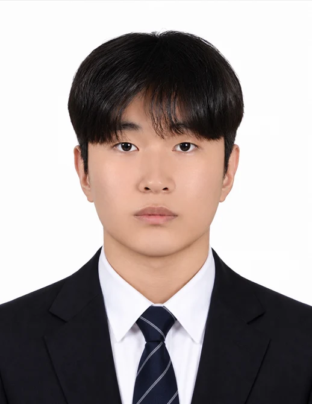

<table>
<tr>
<td width="76%" valign="middle">

<picture>
  <source media="(prefers-color-scheme: dark)" srcset="./assets/readme/header-dark.svg">
  
</picture>

RTL을 설계하고 테스트벤치와 FPGA 보드에서 동작을 확인해 왔습니다. 연산 결과와 <strong>데이터가 갱신·전달되는 시점</strong>을 함께 살피며 원인을 좁힙니다.

병렬 결정트리 연구, AXI4-Lite IP, 영상 좌표 처리, Zynq 출력 제어와 SystemVerilog/UVM 검증을 수행했습니다.

<a href="https://seungyeol-rtl-portfolio.azuretide33.chatgpt.site"><strong>웹 포트폴리오 ↗</strong></a> &nbsp;·&nbsp; <a href="mailto:tmdduf1101@naver.com">이메일</a>

</td>
<td width="24%" valign="middle" align="center">

</td>
</tr>
</table>

[대표 프로젝트](#대표-프로젝트) · [기술](#기술) · [전체 프로젝트](#프로젝트) · [학력·교육](#학력교육) · [수상](#수상)

## 대표 프로젝트

<table>
<tr>
<td width="50%" valign="top">
영상 좌표 처리
<h3>FPGA VGA 지휘 게임</h3>

RED/GREEN 중심 좌표 RTL, 프레임 동기화와 UART–PC UI 연동

<strong>13개 프레임 · 오류 0건</strong> 320×240 좌표 RTL 시뮬레이션

<a href="https://github.com/lsy49055089/RTL-Design-Projects/tree/main/fpga-vga-conductor-game"><strong>설계·검증 내용 보기 ↗</strong></a>
</td>
<td width="50%" valign="top">
AXI4-Lite Custom IP
<h3>MicroBlaze Peripheral System</h3>

IP 5종, Register Map·C MMIO 드라이버와 두 보드 통신 통합

<strong>SPI 32/32 · I2C 30/30 PASS</strong> AXI 프로젝트의 UVM 시험

<a href="https://github.com/lsy49055089/RTL-Design-Projects/tree/main/microblaze-axi4-lite-peripheral-system"><strong>설계·검증 내용 보기 ↗</strong></a>
</td>
</tr>
<tr>
<td width="50%" valign="top">
병렬 탐색 하드웨어 연구
<h3>병렬 결정트리 하드웨어</h3>

현재 노드·좌우 자식의 3-UN 병렬 Datapath와 탐색 제어 FSM 설계

<strong>평균 1.37× 처리 성능</strong> 논문 실험의 순차·병렬 구조 비교

<a href="https://github.com/lsy49055089/Parallel-Decision-Tree-Hardware"><strong>논문·RTL 내용 보기 ↗</strong></a>
</td>
<td width="50%" valign="top">
프로토콜 자동 검증
<h3>SPI · I2C UVM Verification</h3>

RTL·UVM 환경 구성, Scoreboard 비교와 Functional Coverage 확인

<strong>각각 10,000건 · 0 FAIL</strong> I2C Functional Coverage 83.33%

<a href="https://github.com/lsy49055089/RTL-Verification-Projects/tree/main/uvm-spi-i2c-verification"><strong>검증 환경·결과 보기 ↗</strong></a>
</td>
</tr>
</table>

## 기술

| 분야 | 기술 |
|---|---|
| **RTL Design** | Verilog · SystemVerilog · FSM / Datapath · 영상 좌표 처리 · PWM |
| **Verification** | SystemVerilog TB · UVM · Scoreboard · Assertion · Functional Coverage |
| **FPGA / SoC** | Vivado / Vitis · Basys3 · Zybo Z7-20 · MicroBlaze · Zynq PS–PL |
| **Interface** | AXI4-Lite · UART · SPI · I2C · BLE |
| **Software / Embedded** | C · Python · C# / Unity · STM32 · ESP32 · Linux · Git |

---

## 프로젝트

### 01 · RTL / FPGA Design

| 프로젝트 | 담당 역할 | 주요 구현·결과 |
|---|---|---|
| [**병렬 결정트리 하드웨어**](https://github.com/lsy49055089/Parallel-Decision-Tree-Hardware) | 3-UN Datapath·FSM 설계, 제1저자 논문 작성·발표 | 논문 순차/병렬 비교 평균 **1.37×** RTL 분류·동등성 검사 **37개 벡터 결과 일치** |
| [**CNN 모션인식 SoC 플랫폼**](https://github.com/lsy49055089/RTL-Design-Projects/tree/main/zynq-cnn-motion-robot-soc) | PWM IP·C 출력 제어, Record/Replay·DDR/SD 저장, 그리퍼 안정화·Unity | **5축 · 20 ms 제어**, 실물·가상환경 통합 시연 7인 팀 최종 프로젝트 **최우수상** |
| [**MicroBlaze AXI4-Lite Peripheral System**](https://github.com/lsy49055089/RTL-Design-Projects/tree/main/microblaze-axi4-lite-peripheral-system) | Custom IP·Register Map, C MMIO 드라이버, UVM·보드 통합 | **IP 5종**, SPI **32/32**·I2C **30/30 PASS**, 두 보드 통신 |
| [**FPGA VGA 지휘 게임**](https://github.com/lsy49055089/RTL-Design-Projects/tree/main/fpga-vga-conductor-game) | 좌표 처리·곡 디코더 RTL/TB, 군집화·프레임 동기화, PC UI 연동 | RED/GREEN 중심 좌표 추출, 좌표 갱신 지연 수정, **UART–MAESTRO UI 연동** |
| [RV32I Single-Cycle CPU](https://github.com/lsy49055089/RTL-Design-Projects/tree/main/fpga-rv32i-single-cycle) | CPU 전체 RTL·Control Unit·Datapath·TB | **37개 명령어 구현**, Bubble Sort 프로그램 결과 자동 비교 |
| [UART/FIFO 센서 통합 시스템](https://github.com/lsy49055089/RTL-Design-Projects/tree/main/fpga-uart-fifo-sensor-system) | DHT11 Controller·Checksum 검증, 통합 TB·FND 연동 참여 | 40-bit 센서 수신, 시계·센서·UART 통합 동작 확인 |
| [FPGA Stopwatch & Watch](https://github.com/lsy49055089/RTL-Design-Projects/tree/main/fpga-stopwatch-watch) | Stopwatch FSM·Datapath·TB | 100 Hz Tick, Moment Capture, 7-Segment 출력 |

### 02 · Design Verification

| 프로젝트 | 담당 역할 | 주요 구현·결과 |
|---|---|---|
| [**SPI · I2C UVM Verification**](https://github.com/lsy49055089/RTL-Verification-Projects/tree/main/uvm-spi-i2c-verification) | UVM 환경, Driver·Monitor·Scoreboard·Coverage | SPI·I2C **각각 10,000건 트랜잭션 · 0 FAIL** I2C Functional Coverage **83.33%** |
| [UART · FIFO · Parity Verification](https://github.com/lsy49055089/RTL-Verification-Projects/tree/main/systemverilog-uart-fifo-verification) | UART/FIFO RTL, Class-based TB·Reference Queue·오류 주입 | FIFO 순서·UART Loopback 비교, Parity 오류 검출·전달 차단 |

<strong>SPI·I2C 검증 조건과 결과</strong>

 

| 항목 | SPI | I2C |
|---|---|---|
| 트랜잭션 | 10,000건 | 10,000건 |
| Scoreboard 검사 | 10,000 PASS / 0 FAIL | 17,500 PASS / 0 FAIL |
| 조건 | Directed 8 + Random 9,992 | WRITE / READ / WR_RD / WRONG_ADDR 각각 2,500회 |
| Functional Coverage | — | 83.33% · Coverpoint 6개 100%, Cross 3개 각각 50% |

**실행 환경:** 2026.10.19–20 · VCS W-2024.09-SP2 · UVM 1.2 · seed 1234.

I2C는 한 트랜잭션에서 여러 항목을 검사하므로 트랜잭션 수와 검사 수가 다릅니다. 위 시험은 AXI4-Lite 프로젝트의 SPI 32/32·I2C 30/30 시험과 별도입니다.

### 03 · Embedded Systems

| 프로젝트 | 담당 역할 | 주요 구현·결과 |
|---|---|---|
| [BLE·GPS 스마트 캐리어](https://github.com/lsy49055089/Embedded-Systems-Projects/tree/main/smart-carrier-ble-gps) | GPS–ESP32·BLE·지도/캐리어 찾기·SOS/설정·앱 통합·Firebase 배포 | 위치·연결 상태 오류 해결, 팀 안전 기능 통합 · 보호자 알림 수신 미완료 |
| [STM32 Cortex-M4 LED Games](https://github.com/lsy49055089/Embedded-Systems-Projects/tree/main/cortex-m4-led-games) | 타이머·버튼 입력 판정·GPIO·LCD·UART·게임 상태 제어 | 10라운드 반응속도·최대 16단계 기억력 게임 구현 |

### 04 · AI / CV

| 프로젝트 | 담당 역할 | 주요 구현·결과 |
|---|---|---|
| [Multi-Camera Re-ID Tracking](https://github.com/lsy49055089/AI-Projects/tree/main/AI/multicam-cctv-reid) | OSNet 추론 인터페이스·MQTT/Camera A·B 초기 구현·검증 스크립트 | 카메라 간 동일인 연결·경로 판단, Jetson 실행 환경과 이동 시간 조건 점검 |
| [Jetson AI Rock–Paper–Scissors](https://github.com/lsy49055089/AI-Projects/tree/main/AI/jetson-rps-game) | TensorRT 손 영상 분류·4모드 웹 게임 연동 | 실시간 입력·승패·UI 연결, 소스·엔진·UI 자산 자동 검사 |
| [DQN 기반 물류창고 배치 시뮬레이션](https://github.com/lsy49055089/AI-Projects/tree/main/AI/warehouse-dqn) | 개인 프로젝트 · 전처리·창고 환경·보상·DQN·시각화 | 동일 조건 정책 비교, 환경·학습·출력 생성 자동 시험 7개 PASS |

---

## 학력·교육

| 기간 | 활동 | 주요 내용 |
|---|---|---|
| 2026.03 ~ 2026.10 | **서울기술교육센터** | 온디바이스 AI 시스템반도체 설계 2기 |
| 2020.03 ~ 2026.02 | **국립한국교통대학교 전자공학과** | 학사 · GPA 3.54 / 4.5 |
| 2025.11.15 | **한국스마트미디어학회 추계학술대회** | 병렬 결정트리 하드웨어 연구 · 제1저자 발표 |

## 수상

<strong>2026.10.15 · 최종 프로젝트 경진대회 최우수상</strong>

 

- **프로젝트:** CNN 모션인식 SoC 플랫폼
- **교육 과정:** 서울기술교육센터 · 온디바이스 AI 시스템반도체 설계 2기
- **팀:** 7명 · 5개 팀 중 2위 · 전체 참가 34명
- **담당:** AXI4-Lite PWM IP, C 출력 제어·동작 기록/재생, 그리퍼 안정화, Unity 가상환경

[프로젝트 구현과 통합 시연 보기](https://github.com/lsy49055089/RTL-Design-Projects/tree/main/zynq-cnn-motion-robot-soc)

